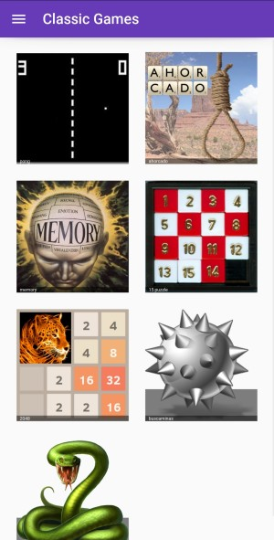

# classic_games

A series of classic games built with [Kivy](https://kivy.org/) and
[KivyMD](https://github.com/kivymd/KivyMD), combined into a single app,
**MDClassics**, with seven games.



The combined app includes:

- Pong
- Ahorcado (hangman)
- Memory
- 15 puzzle
- 2048
- Buscaminas (minesweeper)
- Snake

How to play each game, its controls and its settings are documented on the
[player help website](https://osso73.github.io/classic_games/).

## Running the desktop app

The combined app uses [uv](https://docs.astral.sh/uv/getting-started/installation/)
with Python 3.11 and the Kivy 2.3.1 / KivyMD 2.0.0 baseline. The root
`pyproject.toml` and `uv.lock` are the authoritative dependency definitions; a
runtime `requirements.txt` is generated from the lockfile.

From the repository root, create the locked environment:

```bash
# Working directory: repository root
uv sync --locked
```

Then change into the app directory before launching, because the app loads KV
files and assets through relative paths:

```bash
# Working directory: source/MDclassic_games
uv run --locked python main.py
```

See [Getting started](docs/getting-started.md) for the Python/pip alternative and
desktop prerequisites. Android build and installation instructions are
developer-only and live in [DEVELOPMENT.md](DEVELOPMENT.md).

## Background

The games were originally written one at a time with plain Kivy, and later
brought together under a single KivyMD shell. The standalone game folders and
their historical releases are kept in the repository for reference, but the
combined app in `source/MDclassic_games` is the focus of current development. Its
release history is in the [combined-app changelog](source/MDclassic_games/CHANGELOG.md);
the root [CHANGELOG.md](CHANGELOG.md) links to the historical standalone records.

## Contribution

This project started as a way to practise Kivy and build games for my daughter,
so I do not expect regular collaboration. Feel free to open issues or suggest
improvements, or drop me a mail if you would like to contribute.

## License and credits

The project code is released under the MIT license (see [LICENSE](LICENSE)).
Some bundled images and sounds are third-party assets that may not be used
commercially; only use the project commercially if you replace them with
license-free material. Asset sources and per-game credits are listed in
[docs/about.md](docs/about.md) and in the *Credits* section of each game's help
page.
